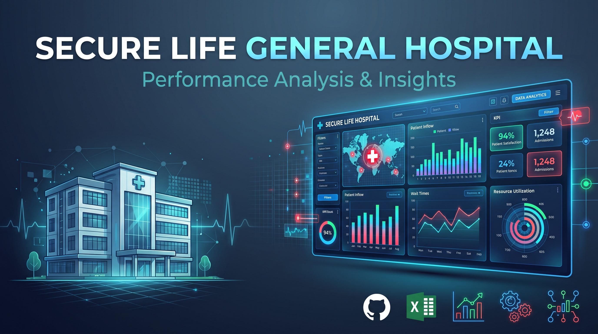
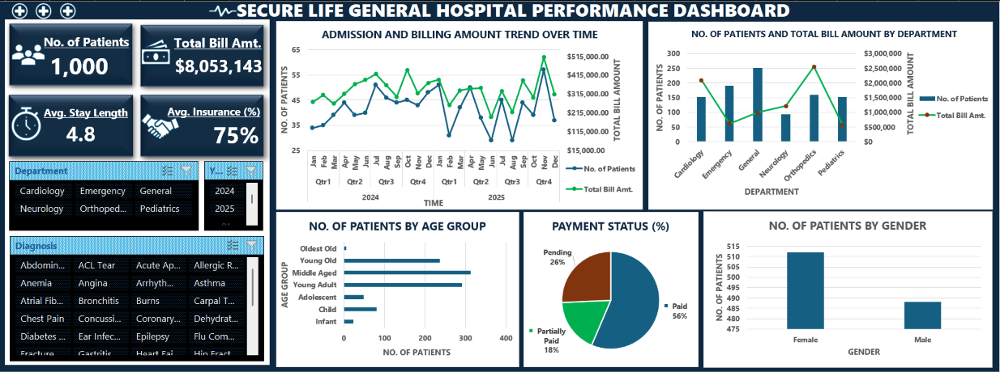

## **INTRODUCTION**

This project is my first individual project as a scholar in the Data Analytics Track of the second cohort of the FadaQa Tech Scholarship Programme (FSP2.0). FadaQa is a non-profit organisation that continues to empower and educate young individuals in the tech space by developing a growing community where these youths can be exposed to the relevant skills, opportunities, mentorship and the network they need to develop themselves, improve their financial and overall wellbeing, and drive useful innovations. As a beneficiary of the FadaQa Tech Scholarship Programme, I have been exposed and instructed on some data analytics technical, as well as soft skills; this project was completed in commitment to the programme as a requirement to demonstrate how much understanding has been gained.

## **ABOUT THE DATASET**

The Secure Life General Hospital Operational and Performance Dataset is a synthetic dataset that has been designed to simulate patients’ admission, billing and insurance patterns in a real-world hospital. The dataset provides clear and structured information about patients’ dates of admission and discharge, attending departments, total bill amounts, percentage insurance coverage and payment statuses gathered from 2024 to 2025. It reflects admission, total bill generation and payment across departments. See dataset [here](Hospital_Patients_Dataset - Working.xlsx).

## **PROBLEM STATEMENT**

The management of Secure Life General Hospital has observed a change in patient admissions, outstanding medical bills, and variations in insurance coverage across its departments. The hospital wants to use patient admission, billing and insurance data to understand its operational performance, monitor payments and improve management decision-making. However, the hospital currently lacks a consolidated report that provides a clear picture of its operational and financial performance. This project analyses the data provided by the management to provide useful insights into the admission trends, billing patterns and payment rates across the major departments that will enable them make informed decisions.

## **VISUALISATION**

Microsoft Excel was the tool employed for the design and development of this interactive dashboard to help the Secure Life General Hospital management monitor performance and make informed decisions.

## **INSIGHTS**

1.	**Total Number of Patients’ visits:** Between 2024 and 2025, the hospital recorded a total of 1,000 individual patients’ visits. Below is the number of patients received by the various departments over this period in descending order:
- General – 252
-	Emergency – 190
-	Orthopedics – 159
-	Pediatrics – 153
-	Cardiology – 152
-	Neurology – 94
2.	**Total Bills Generated by departments (Highest and Lowest):** Across different departments, there are sharp variations in the amounts of bills generated, disproportional to the number of patients received, for instance, despite having the lowest reception of patients, Neurology generates the third highest amount of bills, emphasising the disproportionality of number of patients visits and total bills generated by department. The departments with the highest and lowest total bills generated are:
-	Orthopedics – $2,553,862.00
-	Pediatrics – $572,988.00
3.	**Average Length of Stay by Departments:** Below is the average admission duration of patients by department in no order:
-	Cardiology – 6.5 days
- Emergency – 2.0 days
-	General – 3.9 days
-	Neurology – 6.9 days
-	Orthopedics – 8.4 days
-	Pediatrics – 3.0 days
4.	**Bill Payment Status:** Over the time period, a total bill amount of $8,053,143.00 was generated and of this amount, below is the payment status:
-	Paid – 56%: This reflects an average payment habit and a need for better payment of bills by both patients and health insurance organisations.
-	Partially Paid – 18%
-	Pending – 26%: This proportion of unpaid bills poses a significant potential risk to the hospital’s long term financial returns.
5.	**Variations in Insurance Coverage across Departments and Diagnosis:** Across the different departments, the variations in insurance coverage are negligible, with only about ±1% difference per department from the average total insurance coverage. Across diagnosis however, there are significant degrees of variation, even within the same department. A possible inference is that the percentage of insurance coverage is largely dependent on the patient’s diagnosis, rather than the department.
6.	**Number of Patients by Age Group:** The hospital recorded more visits in the Young Adults (18-44), Middle Adults (45-64) and Young Old (65-84) Categories with the Middle Adults ranking the highest with 313 patient visits. The Infant (0-2), Child (3-11), Adolescent (12-17) and Oldest Old (85+) categories recorded relatively lower number of visits with the Oldest Old category ranking the least with 6 visits. The low record in the oldest old category could possibly be attributed to the Global Life Expectancy sitting at just 73.8 years based on the United Nations Population Estimates (2026) with some countries sitting well below that value.
7.	**Admission and Billing Amount Trend over Time:** Over the 2024-2025 time period, there were variations in the number of patients admitted and the total bills generated. 
-	Admission Trend: There is a rather steady increase in the overall number of patients admitted in the 2024 time period with the peak number in July (51 visits) compared to the 2025 period that is observed to have sharp fluctuations in the number of patients visits with peak visits in November (57 visits) which also accounts for the overall highest number of patients visits for this time period.
-	Billing Amount Trend: Over time, the billing amount followed a closely identical trend pattern with the admission trend with the overall peak amount in November, 2025 ($510,413.50).
8.	**Admission by Gender:** There was a significantly greater number of overall female patient visits than males with 512 and 488 visits respectively, even though it is in the reversed order in the first year. This could suggest greater medical needs or better health awareness amongst females though, there is insufficient information to be certain.

## **AREAS REQUIRING ATTENTION AND RECOMMENDATION FURTHER ANALYSIS**

1.	**Enforce Policies that Improve Bill Payment Rates:** In 2024, there is an overall percentage of 42% of patients that have either partially or pending payment, which is a significant rate, given that this is after a period of over a year at the time of compilation of the dataset. A possible remedy could be to enforce a compulsory 50% payment before discharge, followed by instalment payments over a maximum period of 2 years. This would ensure that the hospital management is in control of how much bill payment it can recover over time.
2.	**Include the Percentage Bills Paid per Patient Visit:** Although it can be clearly inferred that there was 100% and 0% of bills for Individual patients who have completely paid and have pending payments respectively, it is impossible to ascertain the percentage payments for patients who made partial payments. Hence, information on the percentage paid per patient, particularly those who make partial payments should be updated in datasets for future analysis so, there is sufficient information to clearly and correctly determine the total bills paid and the outstanding bills.
3.	**Include Data on how Insurance Coverage is Determined:** Additional data on how insurance coverage is determined by the Health Management Organisation or Government (as may be the case), would provide deeper insights on the variations in the insurance data. There is varying insurance coverage across diagnosis and department and it is unclear how these influence the percentage insurance coverage.

## **CONCLUSION**

This analysis of the Secure Life General Hospital dataset makes it clear that patient inflow alone does not determine total revenue. While units like General and Emergency see the vast majority of patient visits, specialized departments like Orthopedics and Neurology generate most of the hospital’s total revenue due to their longer admission stays and intensive care needs.

Beyond operational volume, the data points to a serious financial bottleneck in how bills are settled. With nearly half of all billed revenue pending or partial paid, the hospital faces a real cash flow challenge. Closing this gap will require practical changes including realistic structured payment policies before discharge. Tracking exactly how much is recovered on partial payments and getting a clearer look at how specific diagnoses drive insurance payouts is invaluable for further analysis. By tackling these operational gaps, management can protect the hospital's financial health without compromising.
